

  
KiCad 2026 · Complete Walkthrough

  
Complete guide · 2026 edition

## Part 1: Schematic Design

### 1.1 Create a New Project
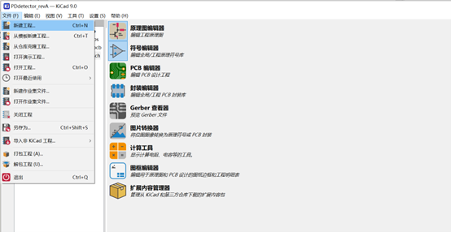

### 1.2 Open Schematic Design
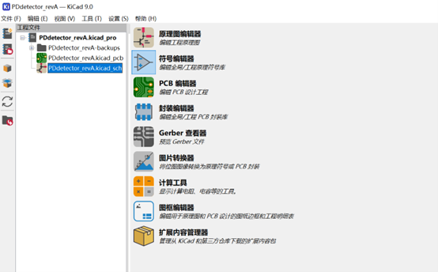

### 1.3 Double-click to Open the Schematic  
By default, this opens the root schematic page.
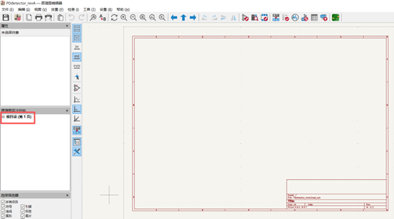

### 1.4 Use Hierarchical Schematic Structure  
The root directory mainly defines the overall logical relationships.
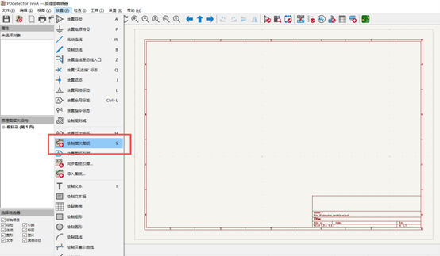

### 1.5 Create Hierarchical Schematics  
Assign meaningful names to hierarchical schematic sheets.
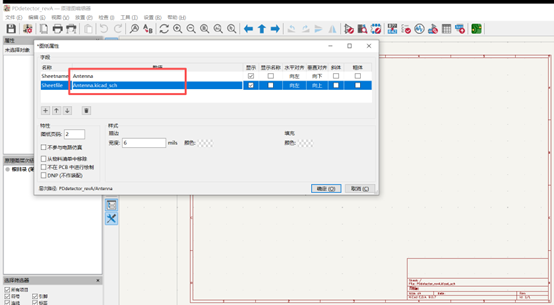

### 1.6 Enter Specific Sheets  
Select components and begin drawing the schematic.
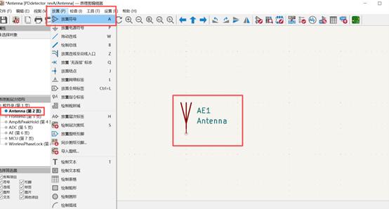

### 1.7 Configure Display Settings  
Adjust page view, cursor, and display preferences.
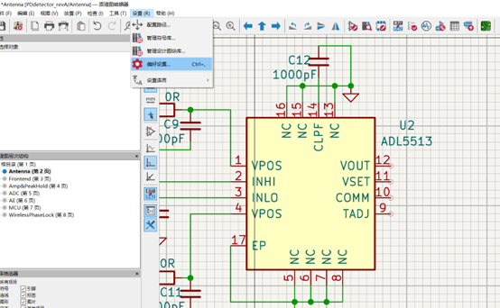

### 1.8 Draw Schematic Symbols  
Use and modify existing symbols as needed.
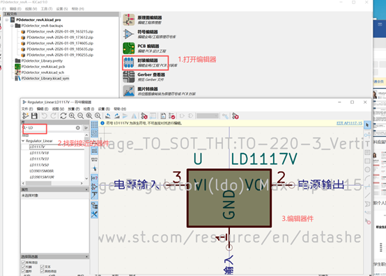

### 1.9 Create a Schematic Library  
Manage custom schematic symbols efficiently.
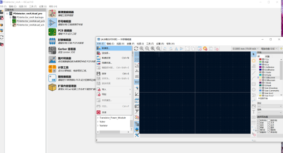

### 1.10 Save Symbols to Your Library  
Store completed symbols in your custom library for reuse.
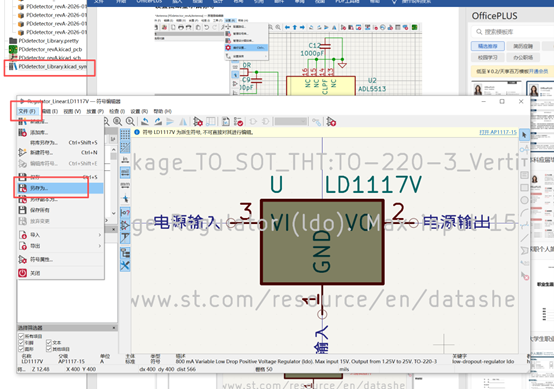

### 1.11 Complete the Schematic Framework
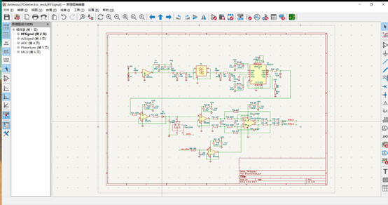

---

## Part 2: Schematic Refinement and Adjustment

### 2.1 Assign Reference Designators by Page Number
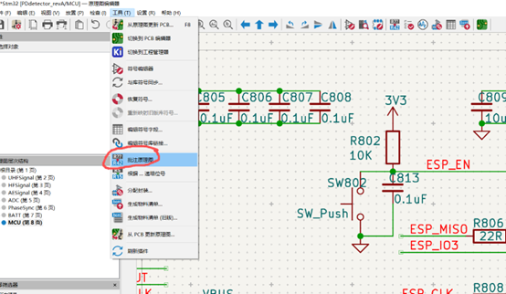

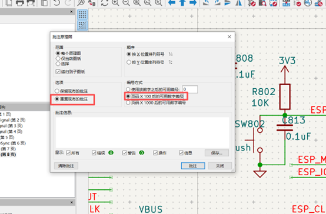

### 2.2 Run DRC (Design Rule Check)
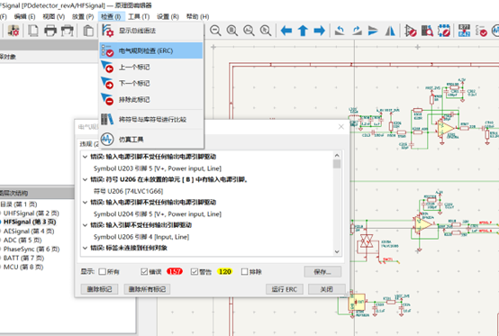

### 2.3 Use Net Labels in Schematics 
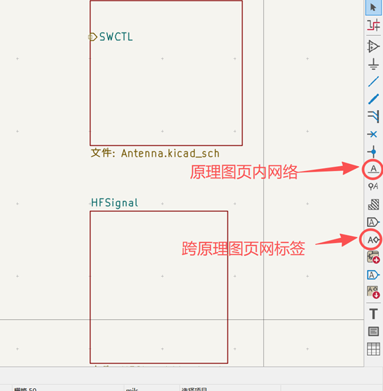

#### 2.3.1 Place Hierarchical Labels Across Different Sheets  
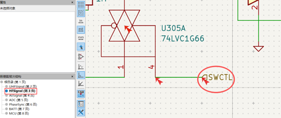

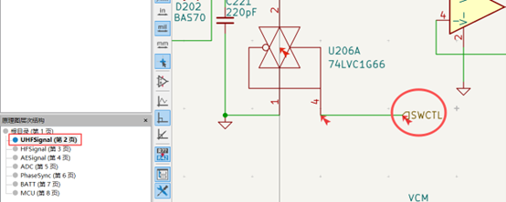

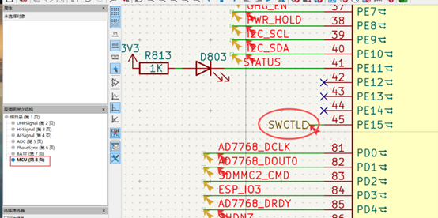

#### 2.3.2 Synchronize Pins and Labels in Root Sheet,Connect hierarchical labels properly.
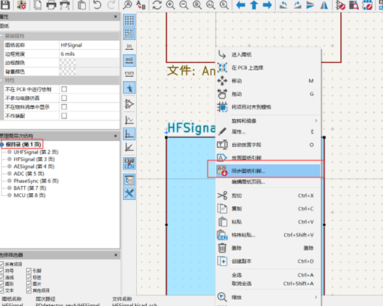

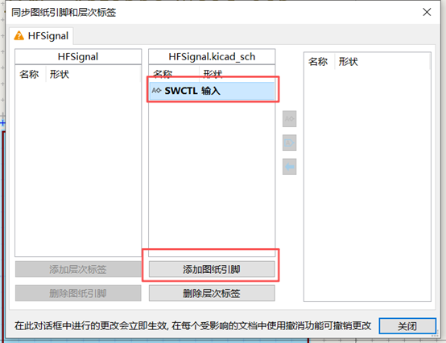

#### 2.3.3 Connect All Hierarchical Labels in Root Sheet  
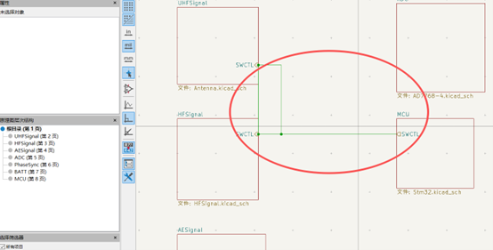

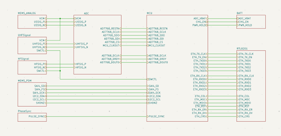

### 2.4 Edit Symbol Properties  

#### 2.4.1 Modify Symbol Attributes,Adjust properties based on requirements.
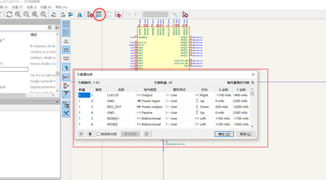

#### 2.4.2 Update Library and Synchronize Changes  
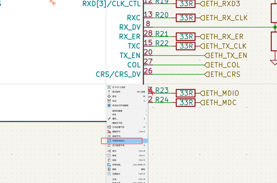

---

## Part 3: Preparation Before Importing to PCB

### 3.1 Perform DRC Check, Ensure no errors; review warnings for PCB impact.
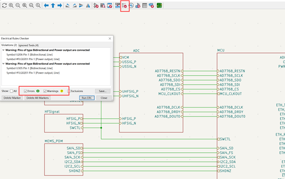

### 3.2 Assign PCB Footprints to Symbols  
- Verify page by page
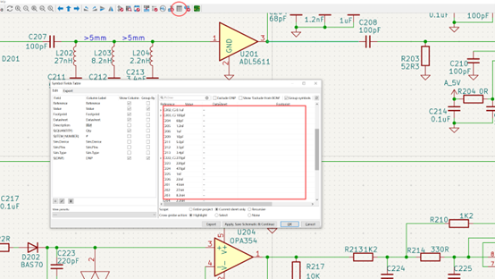  
- Select footprints from libraries
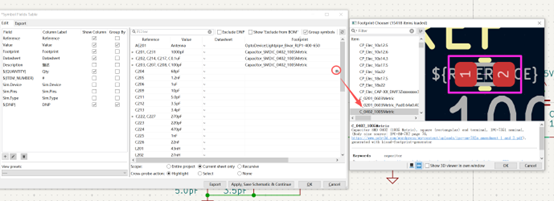
- Modify individual symbol footprints if needed
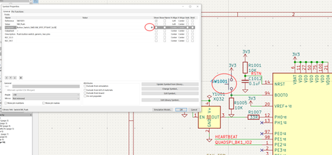
- Ensure all symbols have correct footprints
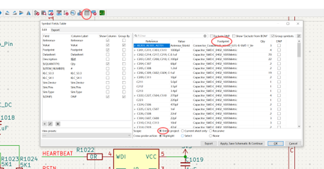

### 3.3 Import Symbols and Connectivity into PCB  
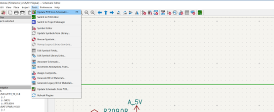

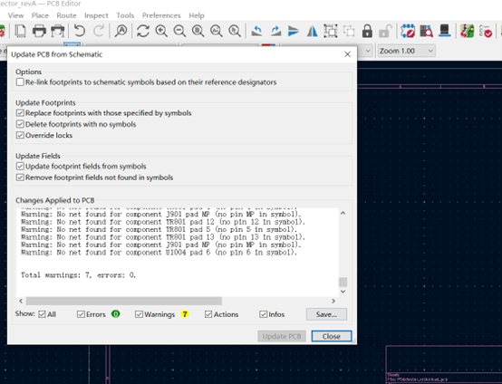

### 3.4 Import Components into PCB
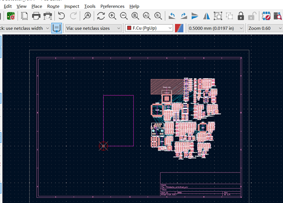

### 3.5 Configure PCB Layer Stack  
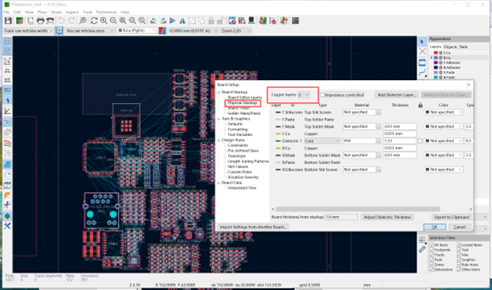

---

## Part 4: Useful Tools in PCB Design

### 4.1 Add Dimension Annotations  
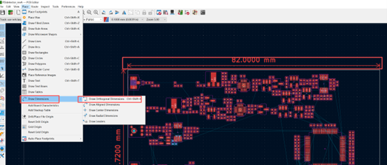

### 4.2 Align Components  
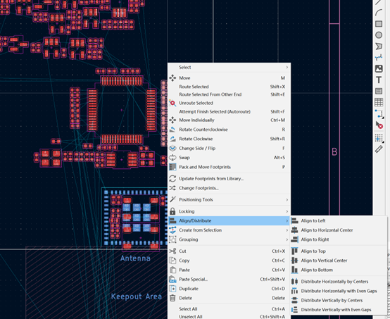

### 4.3 Chamfer Board Outline
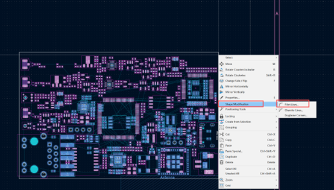

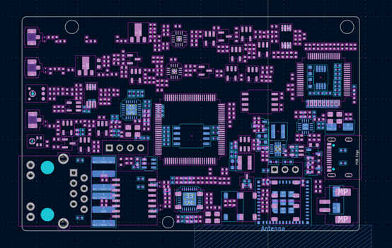

### 4.4 Show/Hide Net Connections  
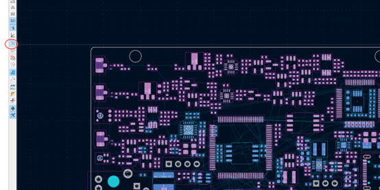

### 4.5 Hide Reference Designators in 3D View  
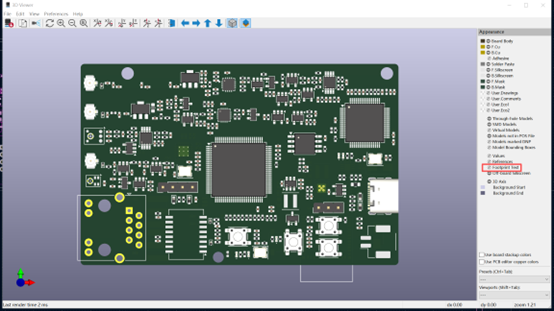

### 4.6 Define Routing Rules
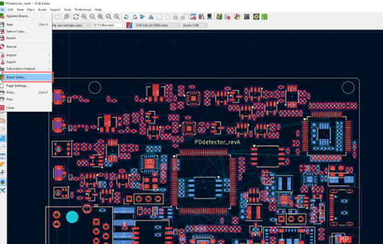

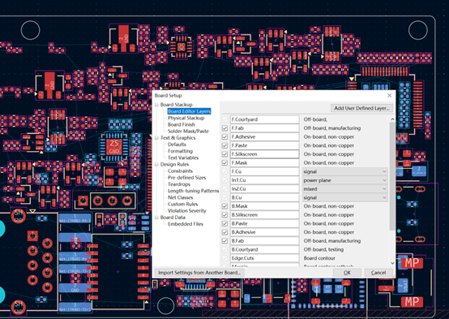

### 4.7 Set 50 Ohm Impedance Traces  
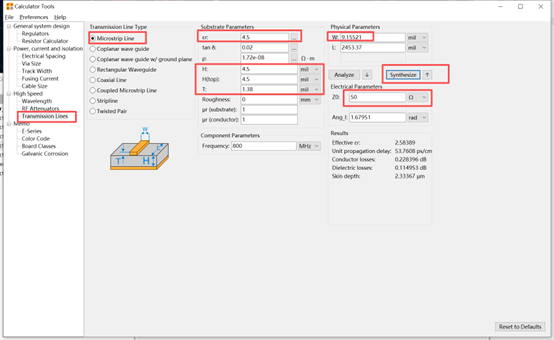

### 4.8 Adjust Trace Width During Routing,Shortcut key: "E"

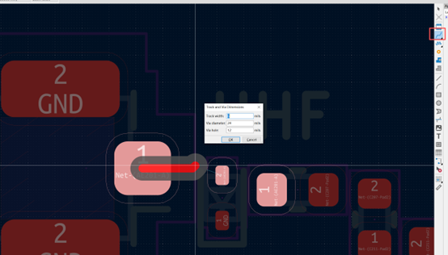

### 4.9 Hide Specific Net Ratsnest Lines  

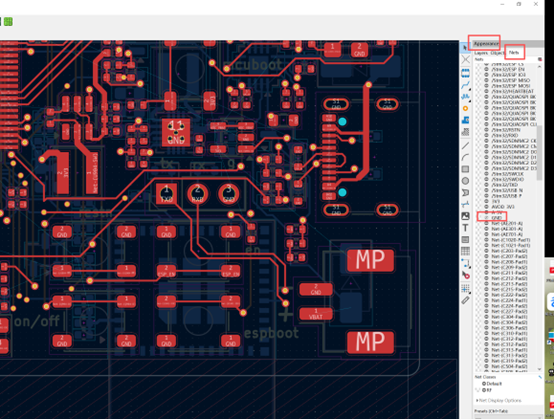

### 4.10 Highlight Nets  

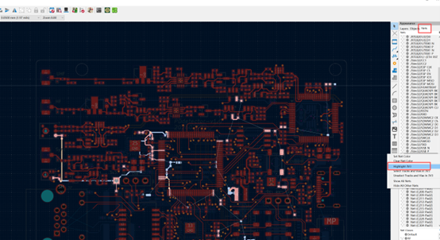

### 4.11 Hide Silkscreen Reference Designators 

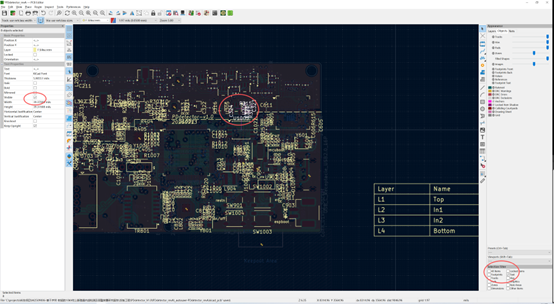

### 4.12 Length Matching Routing,Use the length tuning tool.

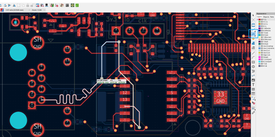

### 4.13 Batch Modify Via Sizes  
- Select the region

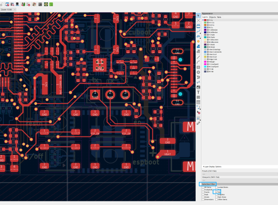

- Modify via parameters

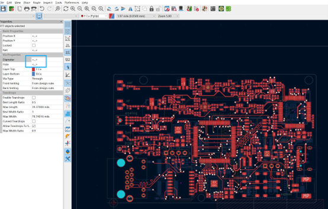

### 4.14 Set Copper Pour Nets  

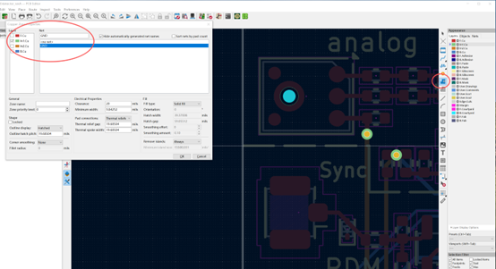

---

## Part 5: Generate PCB Manufacturing Data

### 5.1 Perform Final DRC Check  

### 5.2 Generate Gerber Files  

Select file save location.

### 5.3 Generate Drill Files  

Save in the same location as Gerber files.

### 5.4 Use KiCad Gerber Viewer Verify generated files.  

### 5.5 Generate Position (Pick-and-Place) Files  

Choose save path.

### 5.6 Generate BOM (Bill of Materials)  

OK, all done!

  
KiCad 2026 · 完整实操教程

  
完整教程 · 2026 版

## 第 1 部分：原理图设计

### 1.1 新建项目

### 1.2 打开原理图设计

### 1.3 双击打开原理图
默认会打开根原理图页面。

### 1.4 使用层次原理图结构
根目录主要用于定义整体的逻辑关系。

### 1.5 创建层次原理图
为各张层次原理图纸取有意义的名字。

### 1.6 进入具体图纸
选择元件，开始绘制原理图。

### 1.7 配置显示设置
调整页面视图、光标和显示偏好。

### 1.8 绘制原理图符号
按需使用并修改现有符号。

### 1.9 创建原理图库
高效管理自定义原理图符号。

### 1.10 把符号保存到自己的库
把做好的符号存入自定义库，方便复用。

### 1.11 完成原理图框架

---

## 第 2 部分：原理图的细化与调整

### 2.1 按页码分配参考标号

### 2.2 运行设计规则检查（DRC）

### 2.3 在原理图中使用网络标签

#### 2.3.1 在不同图纸之间放置层次标签

#### 2.3.2 在根图纸中同步引脚与标签，正确连接层次标签。

#### 2.3.3 在根图纸中连接所有层次标签

### 2.4 编辑符号属性

#### 2.4.1 修改符号属性，按需求调整各项属性。

#### 2.4.2 更新库并同步变更

---

## 第 3 部分：导入 PCB 前的准备

### 3.1 执行设计规则检查（DRC），确保没有错误；逐一查看警告是否影响 PCB。

### 3.2 为符号指定 PCB 封装
- 逐页核对

- 从库中选择封装

- 必要时修改单个符号的封装

- 确保所有符号都有正确的封装

### 3.3 把符号与连接关系导入 PCB

### 3.4 把元件导入 PCB

### 3.5 配置 PCB 层叠结构

---

## 第 4 部分：PCB 设计中的实用工具

### 4.1 添加尺寸标注

### 4.2 对齐元件

### 4.3 给板框倒角

### 4.4 显示/隐藏网络连接

### 4.5 在 3D 视图中隐藏参考标号

### 4.6 定义走线规则

### 4.7 设置 50 Ohm 阻抗走线

### 4.8 走线过程中调整线宽，快捷键："E"

### 4.9 隐藏指定网络的飞线

### 4.10 高亮网络

### 4.11 隐藏丝印上的参考标号

### 4.12 等长走线，使用长度调节工具。

### 4.13 批量修改过孔尺寸
- 框选区域

- 修改过孔参数

### 4.14 设置覆铜所属网络

---

## 第 5 部分：生成 PCB 生产数据

### 5.1 执行最终设计规则检查（DRC）

### 5.2 生成 Gerber 生产文件

选择文件保存位置。

### 5.3 生成钻孔文件

保存到与 Gerber 生产文件相同的位置。

### 5.4 使用 KiCad Gerber Viewer 核对生成的文件。

### 5.5 生成坐标（贴片）文件

选择保存路径。

### 5.6 生成 BOM（物料清单）

好了，全部完成！

