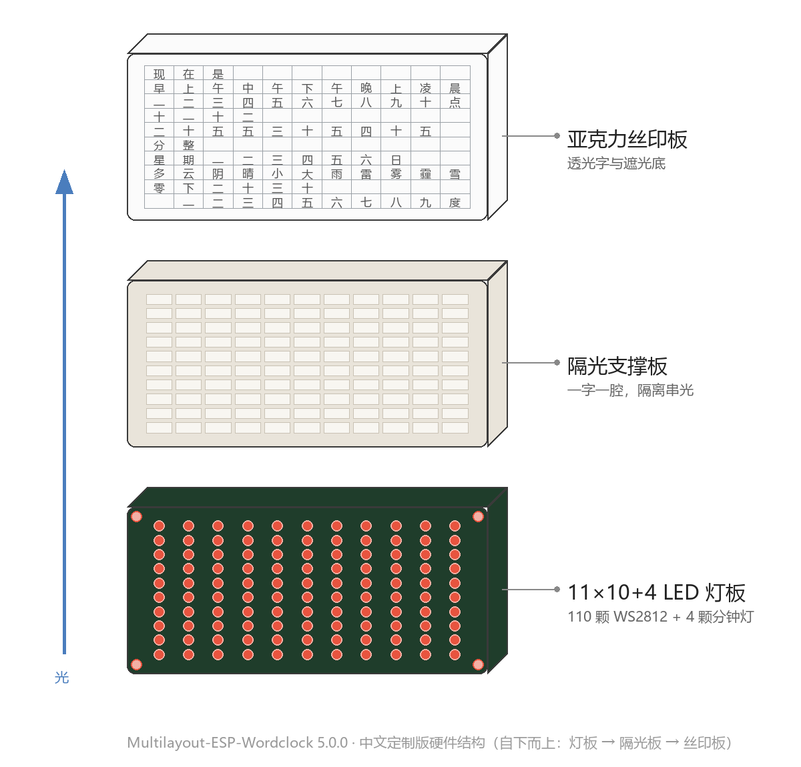
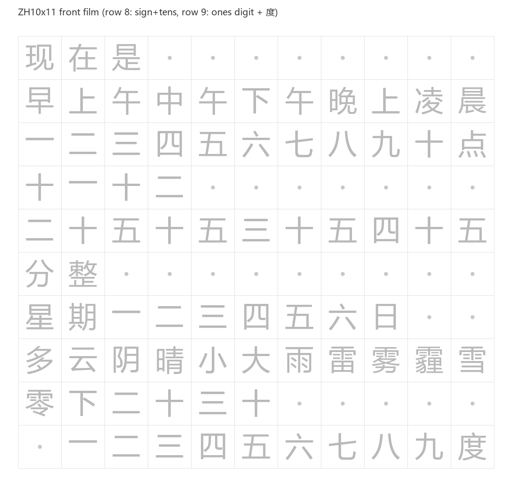
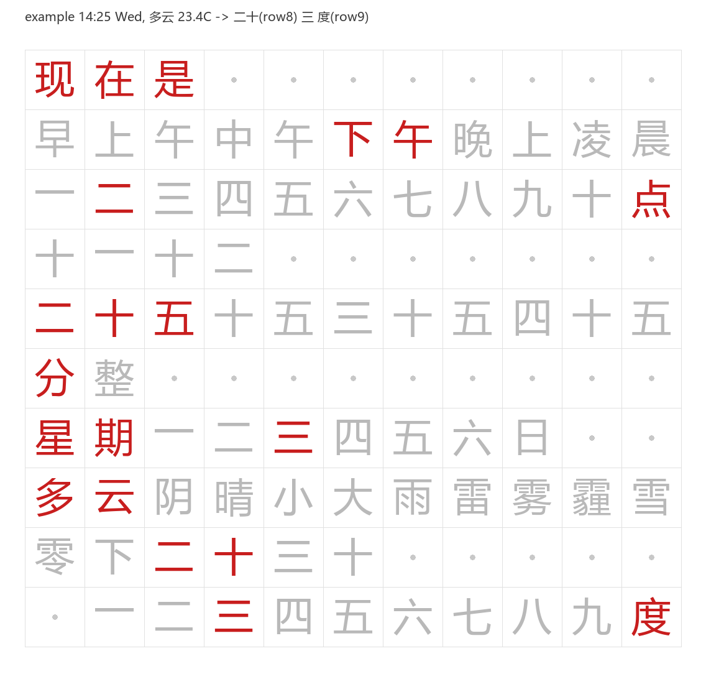

  
From an LED Board to a Chinese Word Clock

  
Word Clock Build Notes · Part 1 of 7 · <a href="/wordclock-series/">Series index</a> · <a href="/posts/wordclock-01-weather-rows-dark/">Next →</a>

*Opening: this is the first article, so there is nothing to pick up from. Ten minutes of background — which open-source project this builds on, how the three boards stack, and why the Chinese panel had to be filled in — makes every later failure land on a specific row of LEDs.*

> The first article in this series is not about a bug. It is about the background: a second-development project built on the official open-source Multilayout-ESP-Wordclock, version 5.0.0. Version one was hardware — an 11×10+4 LED board, an acrylic printed front panel, and a light-blocking support plate. Version two brought Chinese to the firmware. The Chinese layout left many blank cells on the panel, so weekday, weather, and temperature moved into the last rows — and that decision pulled in everything the next six articles describe.

## The starting point: a mature open-source base

I chose to build on this project rather than write one from scratch because it already solves the hardest parts of a word clock:

- **A multi-layout architecture.** Character panels are organized as selectable layouts; German and other languages coexist in one firmware. Adding a language is, in theory, just another layout file — "in theory" turned out to be worth five later articles.
- **A mature render and color pipeline.** Gradients, per-word coloring, and transitions already existed; I only had to feed glyph indices into `show()`.
- **Complete infrastructure.** A web configuration UI (seven languages), OTA updates, MQTT / Home Assistant integration, and a Wi-Fi setup portal all worked out of the box.

I picked 5.0.0 — the first stable release of the 5.x line, freshly reworked in UI, rendering, and stability. The thicker the foundation, the more care each change needs: touching one shared code path means thinking about every layout in seven languages.

## Version one: three boards

The other half of the work is hardware. The device stacks three layers:

- **An 11×10+4 LED board.** 110 WS2812 LEDs in a 10 × 11 grid on the front, plus 4 minute LEDs in the corners — the original project's convention for minutes that don't fill a 5-minute slot. The whole strip is one WS2812 serial chain, driven by NeoPixelBus over I2S/DMA on an ESP8266.
- **An acrylic printed front panel.** Everything the user sees: the translucent characters and the opaque background. Which cells get characters and which stay blank define the whole look of the clock.
- **A light-blocking support plate.** Sandwiched between the LEDs and the panel, with one compartment per cell. Without it, light bleeds sideways through the acrylic and the clock becomes a smear of glow.

Aligning the three layers was the entire engineering effort of version one: LED pitch, compartment holes, and character positions all share one coordinate table. Half a millimeter off, and the light bleeds.

## The turning point: blank cells on the Chinese film

For the firmware stage I cut the Chinese layout `ZH10x11`. Chinese is read in whole words — "现在是 / 下午 / 三点 / 二十五 / 分" — so each word needs only a few characters. Even after compressing the eleven minute readings into one row as a shortest common superstring, the panel still reserved many decorative placeholder cells. German, a letter-based language, reuses characters to build words and fills all 110 cells; Chinese's minimal character set is compact, but any character used by only a few readings leaves its neighbors permanently dark. **A third of the acrylic panel, dark forever** — that is not design, that is waste.

## Turning blanks into information: weekday, weather, temperature

The fix was direct: put content into the blanks. Clock faces have never refused extra information — dates and moon phases came first. The final panel:

- **Row 6:** weekday — Monday through Sunday (a row that already had slack);
- **Row 7:** a superstring of weather conditions — cloudy, overcast, clear, light/heavy rain, thunder, fog, haze, snow;
- **Row 8:** sign and tens digit — zero, below, ten, twenty, thirty;
- **Row 9:** ones digit plus the character for "degrees" — so temperature reads to exactly 1 °C.

On the surface, every cell of the film now does its job. Under the surface, this step turned a "networked clock" into a genuinely networked *information* clock: the firmware must actually fetch data, or the new rows stay dark.

And so the questions lined up: which weather source, how to fit HTTPS and gzip into a 30 KB heap, why the boot loop, how to make the web UI Chinese — the six articles that follow.

## Roadmap of the series

| # | Part subtitle | One line |
|---|---|---|
| 01 | Two dead rows: an investigation that started at "the display looks fine" | One invariant moves the fault from display to data layer |
| 02 | TCP connects, but no response ever arrives | Handshake success ≠ service available |
| 03 | TLS and 6 KB JSON in a 30 KB heap | The memory math of HTTPS on ESP8266 |
| 04 | `wdt reset` on boot: static init to heap fragmentation | Why `getFreeHeap()` lies |
| 05 | One degree on a Chinese word clock: glyphs, layout, film | Display precision touches firmware, glyphs, and film |
| 06 | Just type a city: keyless weather and a Chinese UI | From four configuration steps to one |

Each article follows the same structure: **symptom → investigation → root cause → fix → takeaways**. If you only read two, pick 02 and 04 — one has the counter-intuitive "half-connected network", the other has the concrete "19 KB free yet malloc failed".

## Closing thought

Looking back, the whole series started from one small idea: **don't let characters on the printed film stay dark forever**. Hardware, firmware, glyphs, font conversion, the network stack, i18n — all of it was pulled along by that single thought. The open-source project laid the foundation, the blank cells supplied the motive, and the rest was solving problems one article at a time.

*Next: time and weekday were perfect, weather and temperature were black — starting with “is the panel broken?”.*

  
从一块灯板到一台中文字钟

  
字钟开发调试手记 · 第 1 篇 / 共 7 篇 · <a href="/wordclock-series/">系列目录</a> · <a href="/posts/wordclock-01-weather-rows-dark/">下一篇 →</a>

**开篇**：这是系列的第一篇，没有上一篇可接。先用十分钟交代三件事——底座是哪个开源项目、三层板子怎么叠出来、中文丝印上为什么必须填东西。看完它，后面六篇里每一个故障，你都能对上面板上的一行灯。

> 这个系列的第一篇不是讲 bug，而是讲背景：我基于官方开源项目 Multilayout-ESP-Wordclock 的 5.0.0 版本做二次开发。第一版做的是硬件——11×10+4 的 LED 灯板、亚克力丝印板和隔光支撑板；第二版把固件改成支持中文。中文布局留出了大量空白格，与其让它们常年黑着，不如把星期、天气、温度塞进去——结果这一“塞”，就塞出了后面六篇文章。

## 起点：一个成熟的开源底座

选二次开发而不是从零写，是因为这个项目本身已经把“字钟最难的部分”做完了：

- **多布局架构**。固件按“布局”（Layout）组织字符面板，德语、英语等多个语言版本共存，新增一种语言理论上只是加一个布局文件——后来的实践证明，“理论上”三个字值后面五篇文章。
- **成熟的渲染与配色管线**。渐变色、逐词配色、过渡动画都是现成的，我只管往 `show()` 里喂字模索引。
- **完整的周边设施**。网页配置界面（七种语言）、OTA 升级、MQTT / Home Assistant 接入、WiFi 配网门户，全部开箱即用。

我选定的是 5.0.0——这是 5.x 线的第一个稳定版本，网页界面、渲染管线和稳定性都刚刚整修过。底子越厚，改起来越要小心：动一行公共代码，七种语言的布局都要跟着想一遍。

## 第一版：三块板子

固件之外的另一半工作在硬件上。整机从里到外是三层板子叠出来的：

- **11×10+4 的灯珠电路板**。正面 110 颗 WS2812 排成 10 行 × 11 列的点阵，另外 4 颗分钟 LED 放在角落——这是原项目德语布局的惯例，分钟不满一档（1–4 分钟）时就靠这 4 颗灯补足。整条灯带是一根 WS2812 串行链，ESP8266 用 NeoPixelBus 走 I2S/DMA 驱动。
- **亚克力丝印板**。正面用户看到的一切：透光的字，和不透光的底。哪些格子刻字、哪些格子留白，完全决定了这台钟“长什么样”。
- **隔光支撑板**。夹在灯板和丝印板之间，每个字格一个隔腔。没有它，一颗灯的光会从丝印板里横着漏到隔壁格子——字钟变成一团糊光。

三层板子对齐是第一版的全部工程量：灯珠间距、隔腔开孔、丝印字位，三者共用同一张坐标表。差半个毫米，光就串了。

## 转折：中文丝印的空白格

进入固件阶段后，我把中文布局 `ZH10x11` 刻了出来。中文是整词读数的——“现在是 / 下午 / 三点 / 二十五 / 分”——每个词只需要几个字。即使做了“分钟超串”（把 5 到 55 分钟的十一个读数压进一行 11 个字），整块面板仍然留出了大量装饰占位格：

德语版是字母语言，字符能反复复用组词，110 个格子填得满满当当；中文的最小完备字集虽然精简，可一旦某个字只在少数读数里出现，它周围的格子就常年黑着。**一块亚克力板上三分之一的面积永远是暗的**——这在我看来不是设计，是浪费。

## 把空白变成信息：星期、天气、温度

解法很直接：往空白格里加内容。钟表盘历史上就没拒绝过附加信息，日期、月相都是先例，字钟没有理由只报时间。最终的面板定稿是：

- **第 6 行**：星期一至星期日（时间词占不满的一行，本来就有富余）；
- **第 7 行**：天气状况词的超串——多云、阴、晴、小雨、大雨、雷、雾、霾、雪；
- **第 8 行**：温度符号与十位——零、下、十、二十、三十；
- **第 9 行**：个位数字与“度”——这样气温就能精确到 1℃。

面子上，整块丝印板每个格子都各司其职；里子上，这一步把一台“联网字钟”真正变成了“联网的信息钟”——固件必须真的从网络上拿回数据，才行。

于是问题排着队来了：天气源怎么选、HTTPS 和 gzip 怎么塞进 30 KB 堆、开机为什么 `wdt reset`、网页怎么做成中文……这些就是后面六篇的内容。

## 这个系列的路线图

| # | 本篇副标题 | 一句话概括 |
|---|---|---|
| 01 | 天气两行全灭：一次“显示没问题”的排查 | 用一条判据把故障从显示层锁死到数据层 |
| 02 | TCP 连得上，却永远等不到响应：一次“半连通”网络的排查 | 握手成功 ≠ 服务可用 |
| 03 | 在 30 KB 堆里同时装下 TLS 和 6 KB JSON | ESP8266 跑 HTTPS 的内存账 |
| 04 | 开机就 `wdt reset`：从静态初始化到堆碎片 | `getFreeHeap()` 为什么骗人 |
| 05 | 让中文字钟精确到 1℃：字模、布局与丝印的联动改造 | 一次显示精度牵动固件、字模与丝印 |
| 06 | 只填一个城市：免 key 天气源与中文界面的改造 | 把配置从四步压到一步 |

每篇都按同一个结构写：**现象 → 排查 → 根因 → 解决 → 复盘**。如果你只想挑两篇读，读 02 和 04——一个讲“半连通网络”的反直觉，一个有“19 KB 空闲却 malloc 失败”的具体数字。

## 写在最后

回头看，这一系列工作的起点其实是一个很小的念头：**不要让丝印板上的字常年黑着**。硬件、固件、字模、字体转换、网络栈、i18n，全都是被这一个念头牵着走的。开源项目给了地基，空白格给了动机，剩下的就是一篇一篇把问题解决掉。

*下一篇：时间、星期全对，天气和温度两行却一个灯都不亮——先从「是不是灯板坏了」查起。*

