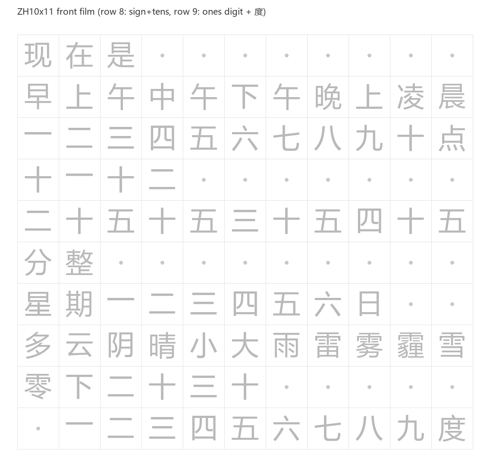
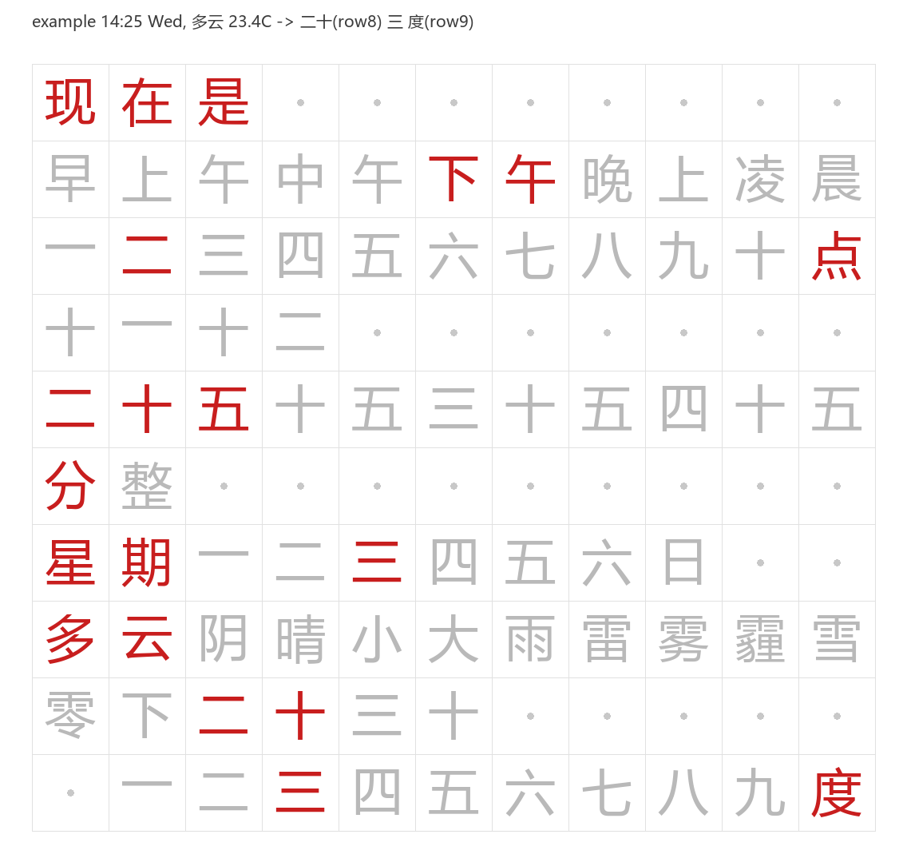

<span data-zh-title="05｜让中文字钟精确到 1℃：字模、布局与丝印的联动改造" hidden></span>

<div class="bi-lang-en" markdown="1">

<span class="bi-lang-mark" data-lang="en" hidden></span>

<div class="bi-series">
  <p class="bi-series-name">From an LED Board to a Chinese Word Clock</p>
  <p class="bi-series-nav">Word Clock Build Notes · Part 6 of 7 · <a href="/wordclock-series/">Series index</a> · <a href="/posts/wordclock-04-boot-loop-heap/">← Prev</a> · <a href="/posts/wordclock-06-keyless-city/">Next →</a></p>
</div>

*Previously: the boot loop was fixed and rows 7–8 finally had content. But the temperature only showed 5 °C steps — twenty, twenty-five, nothing between. One degree meant going back to hardware for one more row.*

## The symptom

Temperature only had six steps: −25, −10, 0, 5, 15, 25, 30 °C. A real 23.4 °C showed "twenty-five degrees"; 9 °C showed "five degrees". The request: one-degree resolution.

The display principle makes that non-trivial. This is not a dot matrix; it is a sheet of acrylic with **one fixed character per cell**. To show "twenty-three degrees", the panel must physically contain 二, 十, 三 and 度 in positions that can be read as a phrase.

## Analysis

A word clock row is a **superstring**: eleven cells must express eleven different minute values, so each row holds a character sequence in which every target word appears as a contiguous run — row 4 reads `二 十 五 十 五 三 十 五 四 十 五`, where 25 is cells 1–3 (二十五) and 45 is cells 8–10 (四十五).

The old temperature row was an imperfect superstring: `零 下 二 十 三 十 五 度` looks like it can spell 二十五, but 二 and 十 sit in cells 3–4 while 五 is in cell 7 — two cells of gap, so the run is not contiguous. The original code sidestepped this by lighting per step, at the cost of never being able to show a units digit.

One-degree resolution needs fifteen characters: 零 下 (sign), 二 三 (tens), 一 through 九 (units), 度 (unit). Two rows give 22 cells. The only free row was row 9 — a decorative couplet — which meant **changing the hardware first**.

## Fix

Reassign the two rows:

```
row 8: 零 下 二 十 三 十 · · · · ·     sign + tens
row 9: ·  一 二 三 四 五 六 七 八 九 度  units + 度
```

| Temperature | row 8 | row 9 | Read as |
|---|---|---|---|
| 23 °C | 二十 | 三 度 | twenty-three degrees |
| 15 °C | 十 | 五 度 | fifteen |
| 5 °C | — | 五 度 | five |
| 30 °C | 三十 | 度 | thirty |
| 0 °C | 零 | 度 | zero |
| −5 °C | 零下 | 五 度 | minus five |

Range ±39 °C, rounded half away from zero.

Three display bugs surfaced along the way and were fixed in the same pass: QWeather icon 104 (overcast) was folded into the "cloudy" group — it got its own group 802; `showChineseWeather()` ran `conditionGroup()` a second time on an already-grouped value, collapsing 802 back to 801; and all rain was shown as heavy rain, now split at 305/309/313/314.

**The front panel has to change with the firmware.** Firmware and silkscreen are two artefacts that drift independently: the old panel has the couplet on row 9, while the new firmware lights the "three" of the new digit row — on the old panel that is a meaningless character. The silkscreen is generated from the layout definition, so regenerating it is one command — except that the script relied on Inkscape for text-to-path conversion, which this machine does not have. A pure-Python fallback (`fontTools` + a system font) now extracts the outlines directly, and the script picks it automatically.

## Verification

A preview tool parses the character grid and the `cells()` mapping from `ZH10x11.hpp` and renders the lit cells for any time and temperature as text or SVG. 23.4 → 二十三度, 10.0 → 十度, 0.3 → 零度, −5.2 → 零下五度, 39.6 → 三十九度 — checked without touching the hardware, in seconds per iteration.

The converted silkscreen was verified geometrically instead of visually: every glyph in the SVG is a path, so `fontTools.pens.boundsPen` gives its bounding box. Two checks — is each glyph centred on its cell centre (derived from 11 × 10 cells at 63 units pitch), and is the largest glyph smaller than the pitch. Result: all 110 glyphs centred, largest 11.49 mm within a 16.67 mm pitch on a 300 mm panel, offset 0.00 mm.

## Takeaways

- **Read the data structure before writing code.** The superstring property means adding one character is a redesign of a row, not an extra line of code. Do the arithmetic on 15 characters and 22 cells first.
- **Hardware and firmware are two halves of one change.** Ship layout, silkscreen and firmware together, and state the order explicitly: panel first, then firmware.
- **Make the invisible measurable.** You cannot see whether a converted glyph is centred, so measure the bounding box; layout changes have a large blast radius, so run the preview across boundary values. Two small scripts replaced a lot of guesswork.
- **List the incidental fixes separately.** "Overcast shown as cloudy" and "all rain is heavy" are semantic bugs that look like a bad data source to the user.

*Next: everything works, but configuration takes four steps — cutting it down to one city name.*

</div>

<div class="bi-lang-zh" markdown="1">

<span class="bi-lang-mark" data-lang="zh" hidden></span>

<div class="bi-series">
  <p class="bi-series-name">从一块灯板到一台中文字钟</p>
  <p class="bi-series-nav">字钟开发调试手记 · 第 6 篇 / 共 7 篇 · <a href="/wordclock-series/">系列目录</a> · <a href="/posts/wordclock-04-boot-loop-heap/">← 上一篇</a> · <a href="/posts/wordclock-06-keyless-city/">下一篇 →</a></p>
</div>

**接上篇**：上一篇把设备从重启循环里捞了出来，第 7、8 行终于有内容。但显示出来的温度只有 5℃ 一档：二十度、二十五度，中间什么都没有。想要 1℃，只能回到硬件——再要一行字。

> 字钟只能显示“零下二十五度、二十度、二十五度”这种 5℃ 台阶。想精确到 1℃，就得再要一行字——而那一行刻着装饰对联「一寸光阴一寸金」。这篇讲字模“超串”怎么设计、为什么 1℃ 需要动前面板、以及如何用脚本代替目测去验证丝印。

## 现象

温度显示只有六个档位：`零下二十五度 / 零下十度 / 零度 / 五度 / 十五度 / 二十五度 / 三十度`。实际 23.4 ℃，钟上显示“二十五度”；实际 9 ℃，显示“五度”。用户要的是“精确到 1 度”。

中文字钟的显示原理决定了这件事不简单：**它不是点阵屏，是一整块刻好字的亚克力，每个格子里固定一个字**。你想显示“二十三度”，板上就必须真的存在「二」「十」「三」「度」这四个字，而且位置要能凑成一句话。

## 分析

**① 字钟布局的本质是“超串”（superstring）设计。**

一行 11 个格子，要能读出 11 种不同的分钟数（5/10/15/…/55），不可能每种数字都刻一遍——所以每一行是一串“能拼出所有目标词”的字符序列：

```
第 4 行：二 十 五 十 五 三 十 五 四 十 五
```

读 25 是「二 十 五」（第 1–3 格），读 45 是「四 十 五」（第 8–10 格）。**每个词必须是这一行里连续的一段**，这就是超串。

**② 现有温度行其实是不完美的超串。**

第 8 行原本是：

```
零 下 二 十 三 十 五 度 · · ·
```

看起来能拼出“二十五”——但「二」「十」在第 3–4 格，「五」在第 7 格，中间隔着两格，点亮是**不连续**的。当年的实现绕过了这个问题（按档位单独点亮），代价是永远无法显示个位数。

**③ 1℃ 需要几个字？**

- 十位：0 / 一十 / 二十 / 三十 → 只需要「十」「二」「三」（中文口语里 10 说“十”，不说“一十”）
- 个位：1–9 → 「一」到「九」
- 符号：负号「零下」的「零」「下」
- 单位：「度」

一共 15 个字要放进现有的两行（22 格）里。原布局第 9 行是一句装饰对联，占满 11 格——**这是唯一可用的空间，但它必须先改硬件**。

## 解决

**① 重新分配两行的职责。**

```
第 8 行：零 下 二 十 三 十 · · · · ·      ← 符号 + 十位
第 9 行：· 一 二 三 四 五 六 七 八 九 度    ← 个位 + 度
```

读法变成“先读第 8 行，再读第 9 行”：

| 温度 | 第 8 行 | 第 9 行 | 读作 |
|---|---|---|---|
| 23 ℃ | 二十 | 三 度 | 二十三度 |
| 15 ℃ | 十 | 五 度 | 十五度 |
| 5 ℃ | — | 五 度 | 五度 |
| 30 ℃ | 三十 | 度 | 三十度 |
| 0 ℃ | 零 | 度 | 零度 |
| −5 ℃ | 零下 | 五 度 | 零下五度 |

范围 ±39 ℃（个位 0–9，十位 0–3），四舍五入：

```cpp
inline int8_t temperatureCelsius(double celsius) {
    const double rounded = celsius >= 0 ? celsius + 0.5 : celsius - 0.5;
    int value = static_cast<int>(rounded);
    if (value > 39) value = 39;
    else if (value < -39) value = -39;
    return static_cast<int8_t>(value);
}
```

**② 顺带修掉三个显示层的 bug。**

改温度时发现天气词也有问题，正好一起修：

- **阴天显示成“多云”**：和风图标 104 是「阴」，原映射把 101–104 一律折进 801（多云）。新增 802 分组，104/154 → 「阴」。
- **重复分组导致新分组失效**：`showChineseWeather()` 里对已经分好组的条件又跑了一次 `conditionGroup()`，把 802 又折回 801。改为直接使用已分组的值。
- **雨不分大小**：原先把所有 3xx 都算「大雨」。改为 305/309/313/314 → 「小雨」，其余 → 「大雨」。

**③ 前面板必须一起换。**

这是本次改动最容易被忽略的风险：**固件和丝印是两套东西，会各自漂移**。老面板第 9 行刻的是「一寸光阴一寸金」，新固件却会去点亮第 9 行的「三」——在旧面板上就是亮了一个毫不相干的字。

丝印是用脚本从布局定义生成的（`svg/createFrontSVG_ZH.py`），改完 `ZH10x11.hpp` 里的网格注释和 `cells()` 坐标后重新跑一遍即可。但脚本原本依赖 Inkscape 做“文字转曲”（转成路径，激光切割不依赖字体），这台机器没装。

于是补了一条纯 Python 的回退路径：`fontTools` + 系统字体（微软雅黑）直接抽取字形轮廓，生成 `_paths.svg`。脚本检测不到 Inkscape 就自动走这条。

## 验证

**① 先在软件里“点亮”一遍。** 写了个预览工具，从 `ZH10x11.hpp` 里解析字符网格和 `cells()` 映射，把任意时刻、任意温度的点亮结果渲染成图或文本：

```
group 801, 23.4 C
row8: 二 十 · · · · · · · · ·
row9: · · 三 · · · · · · · 度
```

逐个核对：23.4 → 二十三度、10.0 → 十度、0.3 → 零度、−5.2 → 零下五度、39.6 → 三十九度。**这一步不用上机，改一次布局跑一次，几秒钟。**

**② 丝印用几何校验，不靠眼睛。** 转曲后的 SVG 里每个字都是一个 `<path>`，用 `fontTools.pens.boundsPen` 算包围盒，检查两件事：

- 每个字的中心是否落在格心（预期坐标由 11 列 × 10 行、格距 63 单位推算）
- 字的最大尺寸是否小于格距（否则会和邻格粘连）

结果：110 个字全部居中在格心，最大字 11.49 mm，格距 16.67 mm（300 mm 板），偏差 0.00 mm。



**③ 最终效果。** 下图是 14:25、多云 23.4 ℃ 的点亮示意，底部三行依次是天气、十位、个位：



## 复盘

- **先看数据结构，再改代码。** 字钟的“超串”特性决定了加一个字不是加一行代码，而是重新设计一行的字符序列；先把 15 个字和 22 个格子的账算清楚，改动才有解。
- **硬件和固件是同一次改动的两部分。** 布局、丝印、固件必须同版本发布，否则会出现“点亮了错误的字”这种最难解释的现象。发布说明里要明确写：**先换面板，再刷固件**。
- **把“看不见的东西”变成可验证的。** 文字转曲后无法用肉眼判断是否居中，所以用包围盒算；布局改动的影响面很大，所以用预览工具跑遍边界值。两个脚本加起来不到 200 行，省下的返工远不止这些。
- **顺手修的小 bug 值得单独列出。** 阴天显示多云、雨不分大小，都是“数据对了但语义错”的问题，不修的话用户会以为是天气源不准。

*下一篇：功能都齐了，配置却要走四步——把它砍到「只填一个城市」。*

</div>
