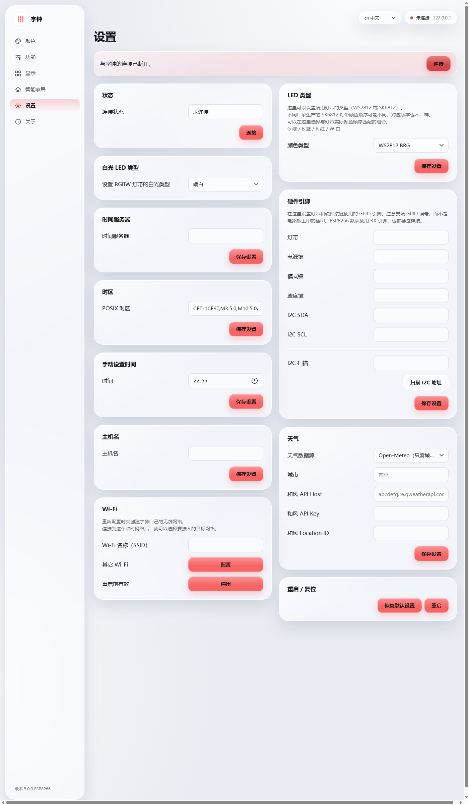
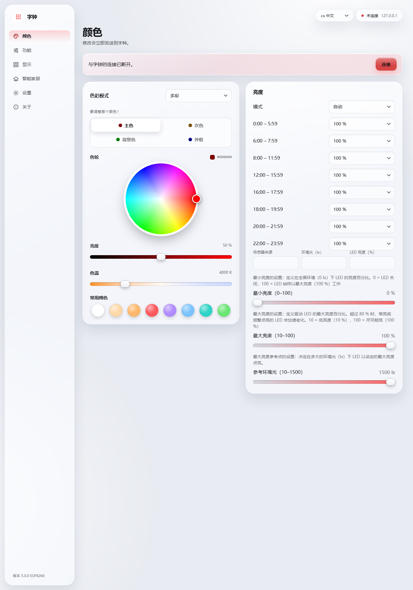

<span data-zh-title="06｜只填一个城市：免 key 天气源与中文界面的改造" hidden></span>

<div class="bi-lang-en" markdown="1">

<span class="bi-lang-mark" data-lang="en" hidden></span>

<div class="bi-series">
  <p class="bi-series-name">From an LED Board to a Chinese Word Clock</p>
  <p class="bi-series-nav">Word Clock Build Notes · Part 7 of 7 · <a href="/wordclock-series/">Series index</a> · <a href="/posts/wordclock-05-one-degree/">← Prev</a></p>
</div>

*Previously: the panel was finalized, 110 LEDs in place, temperature readable to 1 °C. Features were complete; what remained was deliverability — the configuration path still had four steps: register, create a project, copy a key, look up a location ID.*

## The symptom

The feature worked, but the setup flow was still too long for a normal user: register with a weather provider, create a project, copy a 32-character key, look up a 9-digit location ID. Any mistake produced the same result — no weather — with no hint about which field was wrong. The goal: open the page, type "Nanjing", save.

## Analysis

**Choose the provider before writing code.** Few weather APIs are free, keyless and accept a city name. Everything I could think of was tested directly, without a proxy:

| Source | Protocol | City name | Size | Verdict |
|---|---|---|---|---|
| **Open-Meteo** | HTTPS / **HTTP 80** | via geocoding (Chinese OK) | 1147 B plain | **Works**, honours `identity` |
| itboy | HTTP | numeric city code only | 4002 B | fast, needs a code table |
| etouch | HTTP | — | DNS failure | unusable |
| vvhan | HTTPS | — | connect failure | unusable |
| wttr.in | HTTPS | pinyin | 17 B | not Chinese, overseas |

**An accidental discovery removed the whole memory problem.** Testing whether compression could be avoided, I tried port 80 — and it answered:

```bash
curl ... "http://api.open-meteo.com/v1/forecast?...&forecast_hours=24"
# 200 950
```

Plain HTTP means no BearSSL buffers, no MFLN negotiation, no gzip, no uzlib, no fragmentation dance — every workaround from the previous two articles becomes unnecessary on this path. One 4 KB receive buffer is enough.

The protocol detail does change: a plain HTTP/1.0 response has **no `Content-Length`** and is framed by `Connection: close`, so "read exactly Content-Length bytes" must become "read until the peer closes".

**Two requests, but only when the city changes.** Geocoding once (340 B) to turn the name into coordinates, then the forecast every 10 minutes (950 B).

## Fix

**City names are full of traps.** Of seven test inputs, `南京`, `北京`, `乌鲁木齐` and even `Nanjing` work; `南京市`, `义乌市` and `朝阳区` return nothing; `朝阳` resolves to the wrong province. So: strip a trailing 市/区/县 and retry, support `city,province` for disambiguation, and percent-encode the UTF-8 name (one character becomes nine characters in the query string).

**Rewrite the code mapping.** Open-Meteo reports WMO codes, not QWeather icon numbers; translating them into the groups the layouts already understand keeps the display layer untouched.

**Keep storage backward compatible.** Four new fields, appended at the end of `GLOBAL`: `weatherSource`, `cityName[40]`, `latitude`, `longitude`. EEPROM grows from 512 to 768 bytes with every existing offset unchanged, so an upgrade keeps its configuration. Erased flash reads as `0xFF`; the sanitiser then picks QWeather if it is already configured, Open-Meteo otherwise — never breaking a working clock.

**Two new controls in the web UI**: a source dropdown and a city field, with the QWeather trio shown only when selected. The command format grew to five fields while still accepting the old three.

**Adding Chinese exposed an invisible bug.** The page uses i18next; adding a language is one `zh.js` (297 keys), one `<option>`, one resource entry. But Chinese browsers still opened in English: `navigator.language` reports `zh-CN`, i18next looks for `zh-CN`, does not find it, and falls back to `en` — the resource is registered as `zh`. The dropdown value (`zh`) also never matched the resolved language. One line fixes both:

```js
i18next.init({ load: "languageOnly", fallbackLng: ["en"], ... });
```

## Verification

- **Key-set diff** with node: flatten both packs to `a.b.c` lists — 297 vs 297, nothing missing (one missing key and the UI shows the raw key name).
- **curl with the exact device URLs**: forecast 952 B, geocoding 340–360 B, both 200; four cities resolved to the right coordinates.
- **Unit test on the PC**: all WMO codes actually used are mapped; city validation accepts Chinese, commas and spaces, rejects empty and `0xFF`; rounding 23.4→23, 23.5→24, −0.6→−1.
- **Headless browser screenshots** of `?lng=zh`, page by page, to confirm no untranslated strings.
- **Cost**: flash 70.9% → 71.3% (the Chinese pack is ~4 KB gzipped), RAM 67.0%.

## Takeaways

- **Choosing well beats optimising hard.** Two articles of work squeezed 6 KB out of TLS + gzip; a provider that speaks plain HTTP on port 80 makes that cost zero. Look for a shorter road before paving the long one.
- **Keep the old path as a fallback.** QWeather stayed as an option: if the free source disappears, users switch back without waiting for firmware.
- **City names are a product problem.** Nobody blames the API for "Nanjing City" returning nothing; they blame your product. Stripping suffixes, disambiguating and echoing the resolved name back into the field are part of the feature.
- **i18n bugs live in language tags.** `zh-CN` vs `zh`, `pt-BR` vs `pt` — `load: "languageOnly"` belongs in every front-end template.
- **Backward-compatible configuration is cheap and worth it.** Append-only fields, erased-flash sanitising and a sensible default meant the upgrade needed no factory reset.

*That is the series: one panel of blank cells pulled hardware, firmware, glyphs, a network stack and a UI along with it.*

</div>

<div class="bi-lang-zh" markdown="1">

<span class="bi-lang-mark" data-lang="zh" hidden></span>

<div class="bi-series">
  <p class="bi-series-name">从一块灯板到一台中文字钟</p>
  <p class="bi-series-nav">字钟开发调试手记 · 第 7 篇 / 共 7 篇 · <a href="/wordclock-series/">系列目录</a> · <a href="/posts/wordclock-05-one-degree/">← 上一篇</a></p>
</div>

**接上篇**：上一篇把面板定稿，110 颗灯珠各就各位，温度能读到 1℃。功能到这里齐了，接下来是“能不能交付”：当时的配置流程要走四步——注册账号、创建项目、复制 Key、再查一个 Location ID。

> 上一个版本要求用户注册和风天气、创建项目、复制 32 位 Key、再查一个 9 位 Location ID——四步里有三步会劝退人。这篇讲怎么把配置压到“填个城市”，以及为了让中文用户第一次打开网页就是中文，踩到的那个 `zh-CN` 的坑。

## 现象

功能都对了，但配置流程对普通用户来说仍然太长：

```
API Host : xxxxxx.re.qweatherapi.com
API Key  : 32 位十六进制
Location : 101190101
```

任何一项填错，表现都是“天气不亮”，而且看不出错在哪。目标很明确：**打开网页，填「南京」，保存，结束。**

## 分析

**① 先选源，而不是先写代码。** 免注册、免 Key、支持城市名的天气 API 并不多，我把能想到的都实测了一遍（直连，绕开代理）：

| 源 | 协议 | 城市名 | 响应体积 | 结论 |
|---|---|---|---|---|
| **Open-Meteo** | HTTPS / **HTTP 80** | 需先地理编码（中文可） | 1147 B 明文 | **可用**，且尊重 `identity` |
| itboy (`t.weather.itboy.net`) | HTTP | 只认 `101190101` 城市码 | 4002 B | 快，但要内置码表 |
| etouch (`wthrcdn.etouch.cn`) | HTTP | — | DNS 解析失败 | 不可用 |
| vvhan | HTTPS | — | 连接失败 | 不可用 |
| wttr.in | HTTPS | 拼音/英文 | 17 B | 文案非中文、海外节点 |

选 Open-Meteo。它还有一个决定性优点：**`Accept-Encoding: identity` 是生效的**，直接返回明文 JSON。

**② 一个意外的发现，把内存问题整个消掉了。**

本来就是想测“能不能不压缩”，顺手试了下 80 端口：

```bash
curl -s -o /dev/null -w "%{http_code} %{size_download}\n" \
  "http://api.open-meteo.com/v1/forecast?latitude=32.06&longitude=118.78&hourly=temperature_2m,weather_code&forecast_hours=24"
# 200 950
```

**80 端口是通的。** 这意味着：

| | 和风（保留） | Open-Meteo |
|---|---|---|
| 传输 | TLS 443 | **明文 HTTP 80** |
| BearSSL 缓冲 | ~1–12 KB | **0** |
| 压缩 | 强制 gzip | 不压缩 |
| 解压缓冲 | 5–8 KB | **0** |
| 解压代码 | uzlib（1.3 KB RAM） | 不需要 |

前两篇文章里折腾的 TLS 缓冲、MFLN、uzlib、堆碎片，**在这条路径上全部不需要**。一个 4 KB 接收缓冲就够。

但协议细节变了：明文 HTTP/1.0 的响应**没有 `Content-Length`**，靠 `Connection: close` 分帧。原来“抓 Content-Length 再按长度读”的逻辑必须改成“读到连接关闭”。

**③ 两个请求，但只在换城市时发两个。**

```
用户填「南京」→ 保存
   ↓ 仅城市变化时
geocoding-api.open-meteo.com/v1/search?name=南京&count=1&language=zh   (340 B)
   ↓ 拿到 latitude / longitude → 写 EEPROM
api.open-meteo.com/v1/forecast?...&forecast_hours=24&timezone=auto    (950 B)
   ↓ 每 10 分钟刷新，不再地理编码
```

## 解决

**① 城市名的坑比想象中多。** 实测了 7 种输入：

| 输入 | 结果 |
|---|---|
| `南京` / `杭州` / `乌鲁木齐` | ✅ 正确 |
| `北京` / `上海` | ✅ 直辖市正常 |
| `Nanjing` | ✅ 英文/拼音可用 |
| `南京市` / `义乌市` / `朝阳区` | ❌ **无结果** |
| `朝阳` | ⚠️ 命中辽宁朝阳市，不是北京朝阳区 |
| `南京,江苏` | ✅ 逗号可消歧 |

两件事必须处理：**自动去掉「市/区/县」后缀**重试一次；支持 `城市,省份` 消歧。中文名还要做百分号编码——一个汉字 3 字节，编码后 9 个字符，20 行代码。

**② 天气码要重写映射。**

Open-Meteo 用 WMO 码，不是和风的 100/101/104。映射到项目已有的分组后，显示层一行都不用动：

```cpp
inline uint16_t conditionGroupFromWmo(int code) {
    if (code == 0) return 800;                    // 晴
    if (code >= 1 && code <= 2) return 801;       // 少云/多云
    if (code == 3) return 802;                    // 阴
    if (code == 45 || code == 48) return 700;     // 雾
    if (code >= 51 && code <= 57) return 300;     // 毛毛雨
    if (code == 61 || code == 80) return 300;     // 小雨
    if (code >= 63 && code <= 67) return 500;     // 中到大雨
    if (code == 81 || code == 82) return 500;     // 阵雨
    if (code >= 71 && code <= 77) return 600;     // 雪
    if (code == 85 || code == 86) return 600;     // 阵雪
    if (code >= 95) return 200;                   // 雷
    return 0;
}
```

**③ 存储要能向后兼容。** 新增四个字段，全部追加在 `GLOBAL` 末尾：

```c
uint8_t weatherSource;   // 0 = Open-Meteo, 1 = QWeather
char    cityName[40];    // UTF-8，约 13 个汉字
float   latitude;
float   longitude;
```

EEPROM 从 512 扩到 768 字节，但**所有旧字段偏移不变**，所以升级不丢配置。擦除态读出来是 `0xFF`，清洗逻辑按“如果和风已配置就继续用和风，否则默认 Open-Meteo”来选——**不打断正在工作的设备**。

**④ 网页只加两个控件。** 数据源下拉 + 城市输入框，和风三项按数据源显示/隐藏；命令格式改成五段并兼容旧的三段格式；7 个语言包的文案补齐。



**⑤ 加中文界面，踩到一个“看不见”的坑。**

网页的 i18n 用的是 i18next，加语言本身很直接：一个 `zh.js`（297 个键）、一个 `<option>`、注册进 resources。但中文浏览器打开仍然是英文。

原因：`navigator.language` 报的是 `zh-CN`，i18next 会先找 `zh-CN`，找不到再回退到 `en`——而我们注册的资源叫 `zh`。同时下拉框的 `value` 是 `zh`，`resolvedLanguage` 却可能是 `zh-CN`，选中状态也对不上。

```js
i18next.init({
    load: "languageOnly",   // zh-CN → zh，de-DE → de
    fallbackLng: ["en"],
    ...
});
```

一行配置解决。顺手把 `<html lang>` 同步成实际检测到的语言，中文断行和字体回退才正确。

## 验证

- **键集合比对**：用 node 加载两个语言包，拍平成 `a.b.c` 列表求差集——297 vs 297，无缺失、无多余（少一个键，界面上就会出现 `settings.weather.city` 这种原始键名）。
- **按设备真实 URL 跑 curl**：预报 952 B、地理编码 340–360 B，均 200；`南京 / 乌鲁木齐 / 呼和浩特 / 三亚` 全部命中正确坐标。
- **映射单测（PC 上编译头文件）**：WMO 0–99 中实际会用到的码全部有映射；城市校验接受中文/逗号/空格，拒绝空串与 `0xFF`；温度四舍五入 23.4→23、23.5→24、−0.6→−1。
- **界面截图**：本地起静态服务，headless 浏览器打开 `?lng=zh`，逐页确认没有未翻译文本。



- **资源代价**：Flash 70.9% → 71.3%（中文语言包 gzip 后约 4 KB），RAM 67.0%。

## 复盘

- **选型的价值大于优化。** 前面几篇为了在 TLS + gzip 下省出 6 KB 花了很大力气；换成支持明文 80 端口的源，这些开销直接变成 0。**先找一条更短的路，再优化路上的坑。**
- **“降级”要保留旧路径。** 和风没有被删掉，而是作为可选项保留：免 key 源哪天挂了，用户切回和风即可，不用等新固件。
- **城市名是产品问题，不只是技术问题。** “南京市查不到”这种细节，用户不会认为是 API 的锅，只会认为是你的产品坏了。去后缀、逗号消歧、把解析结果回显到输入框，都是必要的产品设计。
- **i18n 的坑都在“语言标签”上。** `zh-CN` vs `zh`、`pt-BR` vs `pt`——`load: "languageOnly"` 这一行，值得写进任何前端项目的模板里。
- **兼容旧配置的成本很低，收益很高。** 结构体末尾追加 + 擦除态清洗 + 默认值策略，让升级不需要“恢复出厂设置”。

*系列到此结束：一块丝印板上的空白格，最终牵出了硬件、固件、字模、网络栈和界面的一整条改造链。*

</div>
