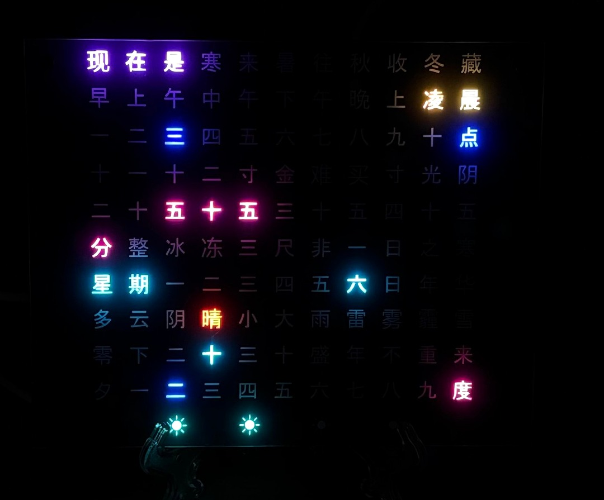
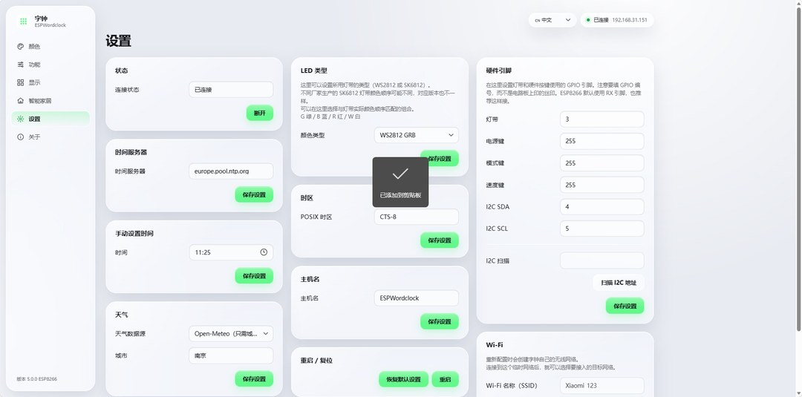
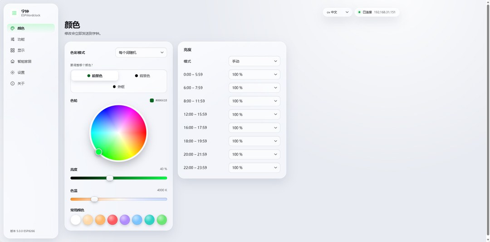
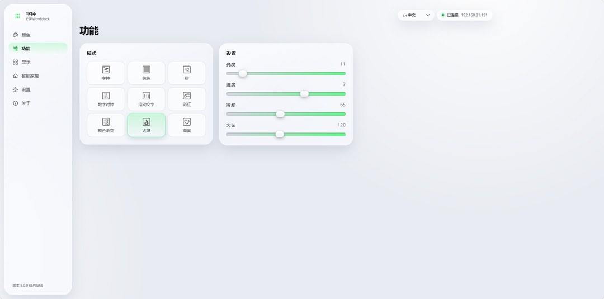
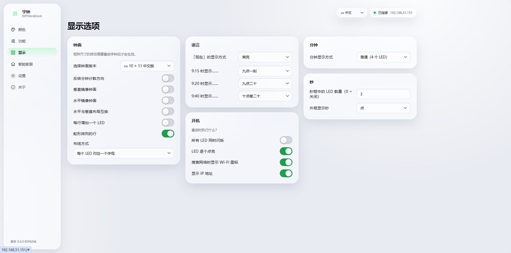
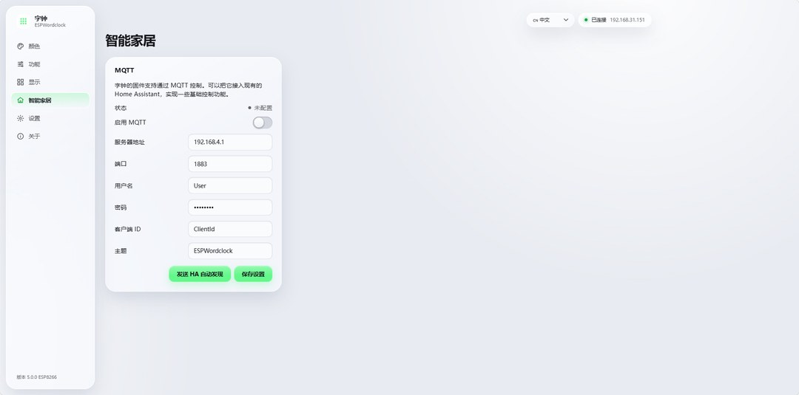
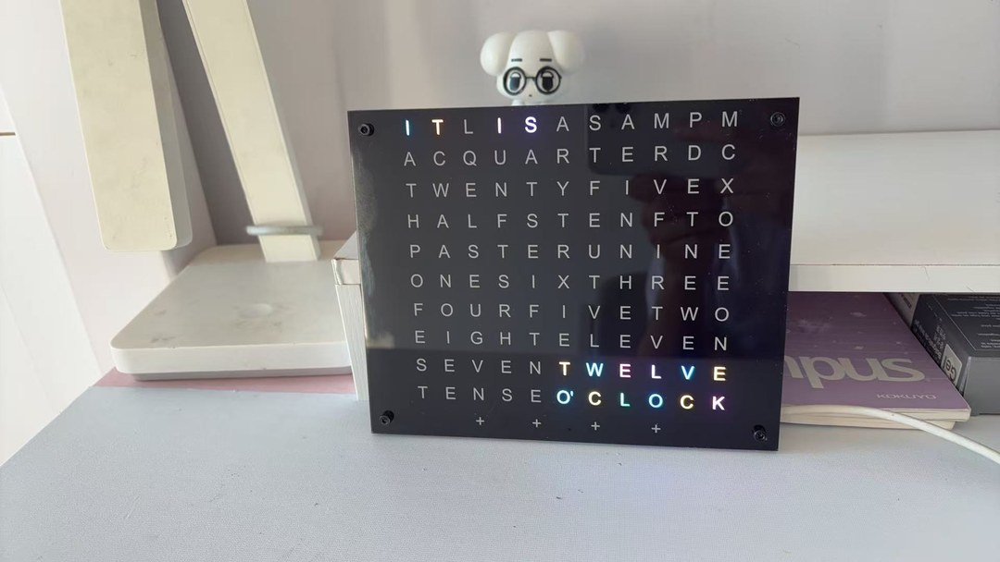

  
The Chinese Word Clock

  
Features &amp; everyday use · <a href="/projects/wordclock/">Project page</a> · <a href="/wordclock-series/">Build notes</a>

In the evening, a black panel in the corner of the desk lights up.

Not with blinking digits, not with a cold "16:35".

A sentence in Chinese appears, line by line —

**It is | afternoon | four thirty-five | Saturday | cloudy | seventeen degrees**

One last line keeps a saying company: *Sheng nian bu chong lai* — prime years do not come again.

Time, written as a sentence.

## It does more than "tell the time"

A digital clock hands you a set of digits, and you translate them in your head: 16:35 is afternoon, it's four thirty-five.

This one does the translating for you.

"It is", "morning", "noon", "afternoon", "evening", "before dawn" light up by context; so do "one o'clock", "a quarter past", "half past", "twenty to". You read what you would actually say out loud.

The better part is the cells that stay dark. Chinese word clocks spell time in whole words, which leaves stretches of blank cells on the panel. Instead of letting them sit idle, this panel fills them with lines:

> Cold and heat come and go; autumn brings the harvest.
> An inch of time is worth an inch of gold.
> A three-foot freeze is not the work of a single day.
> Prime years do not come again.

Not one cell is there just to fill space. You check the time and end up reading an old saying.

## Weather and temperature, written on the face too

The last rows of the panel are reserved for the weekday, the weather and the temperature.

Cloudy, overcast, clear, light rain, heavy rain, thunder, fog, haze, snow — the weather is written in Chinese on the panel, no icon decoding needed. The temperature reads to **1 °C**, and below zero works too: "minus twenty-one degrees" lights up in full rather than a vague range.

Setup is simple. Connect to your home Wi-Fi, open the configuration page in a phone browser, and under weather just type the **city name** — no codes to memorise, no key to request. If you prefer your own weather service, a QWeather option is kept as an alternative.

One glance before you head out: has it cooled down, do you need an umbrella? No need to reach for your phone.

## Everything is set from a phone browser

The clock's whole "personality" can be tuned from your phone.

The configuration page has six entries on the left: **Colors, Functions, Display, Smart Home, Settings, About**. Chinese interface, open it and it's already in Chinese.

**Colors** — pick any shade on the wheel, then set brightness for 8 time slots separately: a little brighter by day, softer late at night. Common colours switch in one tap.

**Functions** — clock, seconds, digital clock, scrolling text, alarm, light effects and more, with brightness, speed, cooling and spark sliders. Quiet or lively, your call.

**Display** — choose how Chinese time is phrased: "a quarter past nine", "nine twenty", "twenty to ten". How minutes show, how many seconds LEDs light, how the panel wakes up — all adjustable.

**Smart Home** — connect it to your home automation so the clock works with your lights and scenes. Time sync, timezone and Wi-Fi are set once and then looked after automatically.

## Chinese and English, whichever suits the room

There are **two versions, Chinese and English**: the Chinese one reads "It is, four thirty-five in the afternoon"; the English one uses the familiar "IT IS / HALF TEN / O'CLOCK".

A black panel, 110 full-colour LEDs plus 4 corner LEDs, 5 V Type-C power — a phone charger is enough to light it up. On a desk, shelf, hallway table or in the living room, it's a quiet object by day and a sentence after dark.

---

What makes a clock worth keeping isn't how precise it is. It's that it says the time, the weather and the temperature in a language you actually think in.

For the full feature list and setup notes, see the [project page](/projects/wordclock/).

  
中文字钟

  
功能与日常使用 · <a href="/projects/wordclock/">项目介绍</a> · <a href="/wordclock-series/">开发手记</a>

晚上回到家，桌角那块黑色的面板亮了。

不是跳动的数字，也不是冷冰冰的「16:35」。

一行行中文慢慢浮出来——

**现在是｜下午｜四点三十五｜星期六｜阴｜十七度**

最后一行，还留着一句「盛年不重来」。

时间，被写成了一句话。

## 它不满足于「告诉你几点」

数字钟给出的是一组数字，你需要先在脑子里翻译一遍：16:35 是下午，是四点三十五。

这块钟直接把翻译做完了。

「现在是」「早上」「上午」「中午」「下午」「晚上」「凌晨」按语境点亮；「一点」「两点」「一刻」「半」「差十分」也按中文习惯组合。你看到的就是你平时会说出来的那句话。

更妙的是那些没被点亮的格子。中文按整词显示，面板上原本会留下大片沉默的空格。这里没有让它们黑着，而是填进了句子：

> 寒来暑往，秋收冬藏。
> 一寸光阴一寸金。
> 冰冻三尺非一日之寒。
> 盛年不重来。

于是整块板没有一处是「凑数」的空白。看时间的时候，顺手把一句老话也读了。

## 天气和温度，也写在钟面上

钟面的最后几行，留给了星期、天气和温度。

多云、阴、晴、小雨、大雨、雷、雾、霾、雪——天气用中文写在面板上，不用识别图标。温度精确到 **1℃**，零下也能显示：「零下二十一度」会完整地亮出来，而不是含糊地显示一个区间。

设置也简单。连上家里的 Wi-Fi，在手机浏览器里打开配置页面，天气那里只填**城市名**就行——不用记代码，也不用申请什么密钥。想用自己的天气服务，也留了和风天气作为备选。

出门前抬头瞄一眼：降没降温、要不要带伞，不用再专门摸出手机。

## 所有设置，都在手机浏览器里

这块钟的「脾气」，都能在手机里调好。

配置页面左侧六个入口：**颜色、功能、显示、智能家居、设置、关于**。中文界面，打开就是中文。

**颜色**：一个色轮随便取色，下面还能按 8 个时段分别设定亮度——白天亮一点，深夜柔一点。常用颜色一键切换。

**功能**：时钟、秒钟、数字钟、滚动文字、闹钟、光效等多种模式，亮度、速度、冷却、火花四个滑杆，想让它安静还是热闹，自己说了算。

**显示**：中文读数习惯可以改，「九点一刻」「九点二十」「十点差二十」都由你定；分钟怎么显示、秒灯亮几颗、开机时怎么点亮，也都能调。

**智能家居**：接进家里的自动化系统，让这块钟和家中的灯、场景一起联动。对时、时区、Wi-Fi 这些设置一次就好，之后自动校准，不用惦记。

## 中英两版，摆在哪都合适

手上有**中文和英文两个版本**：中文版是「现在是，下午四点三十五」；英文版是大家熟悉的「IT IS / HALF TEN / O'CLOCK」。

一块黑色面板，110 颗全彩灯珠加 4 颗角落灯，5V Type-C 供电——一个手机充电头就能点亮。放在书桌、书架、玄关或客厅，白天是件安静的摆件，晚上亮起来就是一句话。

---

一块钟真正打动人的地方，不是它多准，而是它愿意用你熟悉的语言，把时间、天气和温度慢慢写出来。

完整的功能与配置说明，见[项目介绍页](/projects/wordclock/)。

