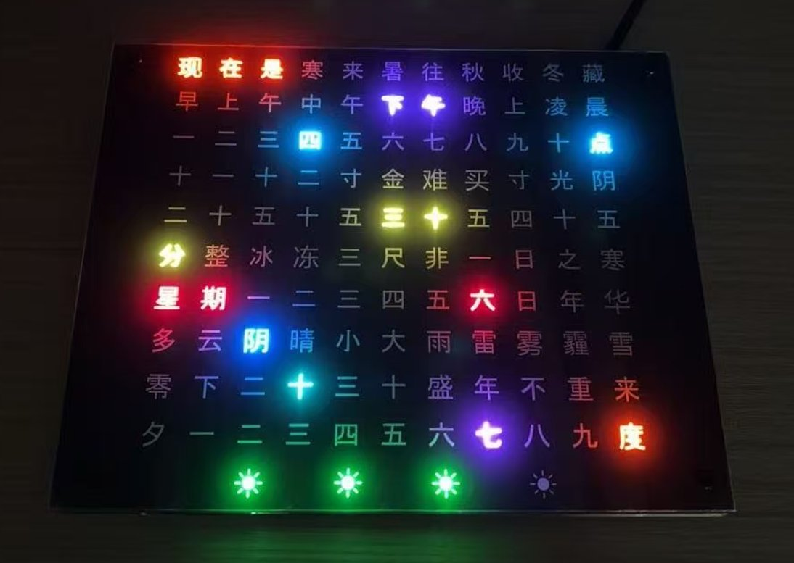

<!-- 页面大标题的中文（放在正文第一行，不会显示） -->

<!-- ↓↓↓ 英文正文 ↓↓↓ 哨兵 span 必须保留在块内第一行 ↓↓↓ -->

## The kit

A DIY kit for the **11×10 Chinese word clock**: a character grid where Chinese phrases light up as whole words — and, unlike the stock layout, the spare cells on the film are put to work showing **weekday, weather, and temperature down to 1 °C**.

The firmware is based on the open-source [Multilayout-ESP-Wordclock 5.0.0](https://github.com/ESPWortuhr/Multilayout-ESP-Wordclock) — full fork sources: [github.com/bi4wmslabs/Multilayout-ESP-Wordclock-ZH](https://github.com/bi4wmslabs/Multilayout-ESP-Wordclock-ZH) — with a custom ZH10x11 Chinese layout, keyless Open-Meteo weather (just type a city in the web UI), optional QWeather, OTA updates, and a fully bilingual web interface. See the [project page](/projects/wordclock/) for the full feature list and the [7-part build & debugging series](/wordclock-series/).

## What the kit contains

| Item | Notes |
| --- | --- |
| LED board | 11×10 WS2812/SK6812 matrix + 4 corner minute LEDs |
| Acrylic silkscreen film | ZH10x11 layout, laser-printed light-blocking layer |
| Light-blocking support plate | One cavity per character, prevents crosstalk |
| Controller | ESP8266 (NodeMCU), flashed and tested before shipping |

The final packing list and kit options (bare PCB / full kit / assembled unit) are being confirmed and will be published here before orders open.

## Firmware features

- Chinese ZH10x11 layout with weekday, weather, and 1 °C temperature rows
- Dual weather sources: Open-Meteo (keyless, city name) or QWeather (location ID + key)
- Bilingual EN/中文 web UI with OTA firmware updates
- NTP time sync, POSIX timezone, MQTT / Home Assistant support from upstream

## Pricing, delivery and support

Pricing and the checkout link are being finalised. Until then, use the enquiry button to ask about availability, lead time and shipping destinations. Build guidance and the full debugging notes are published free in the series.

<!-- ↓↓↓ 中文正文 ↓↓↓ -->

## 套件介绍

**11×10 中文字钟** 的 DIY 套件：一块按中文整词点亮的字符面板——与原版布局不同，丝印板上的空余格子被利用起来，显示**星期、天气和精确到 1℃ 的温度**。

固件基于开源项目 [Multilayout-ESP-Wordclock 5.0.0](https://github.com/ESPWortuhr/Multilayout-ESP-Wordclock) 二次开发——完整分支源码：[github.com/bi4wmslabs/Multilayout-ESP-Wordclock-ZH](https://github.com/bi4wmslabs/Multilayout-ESP-Wordclock-ZH)，包含自绘 ZH10x11 中文布局、免 key 的 Open-Meteo 天气（网页里只填城市名）、可选的和风天气、OTA 升级和完整的中英双语网页界面。完整功能列表见[项目页](/projects/wordclock/)，开发过程见[系列文章](/wordclock-series/)（共 7 篇）。

## 套件包含

| 物品 | 说明 |
| --- | --- |
| LED 灯板 | 11×10 WS2812/SK6812 矩阵 + 4 颗角落分钟灯 |
| 亚克力丝印板 | ZH10x11 布局，激光打印遮光层 |
| 隔光支撑板 | 一字一腔，防止光线串扰 |
| 主控 | ESP8266（NodeMCU），发货前已烧录并测试 |

最终装箱清单与套件档位（裸 PCB / 全套件 / 成品整机）确认后会在开放购买前公布于本页。

## 固件功能

- 中文 ZH10x11 布局，含星期、天气与 1℃ 温度行
- 双天气数据源：Open-Meteo（免 key，填城市名）或和风天气（Location ID + Key）
- 中英双语网页界面，支持 OTA 固件升级
- NTP 对时、POSIX 时区，保留上游的 MQTT / Home Assistant 支持

## 价格、交付与支持

价格与结账链接确认中。在此之前，可通过询价按钮咨询供货情况、交期与可配送地区。制作指南与完整调试笔记在系列文章中免费公开。

