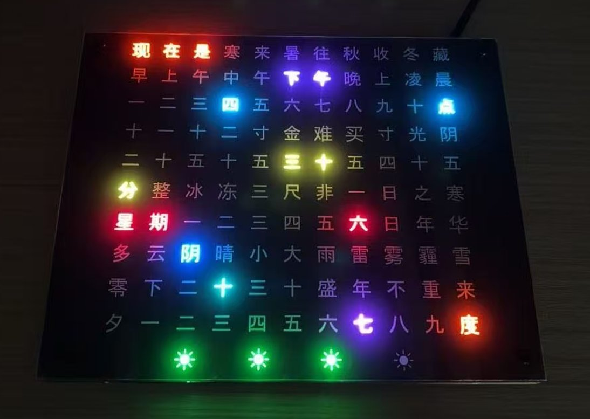
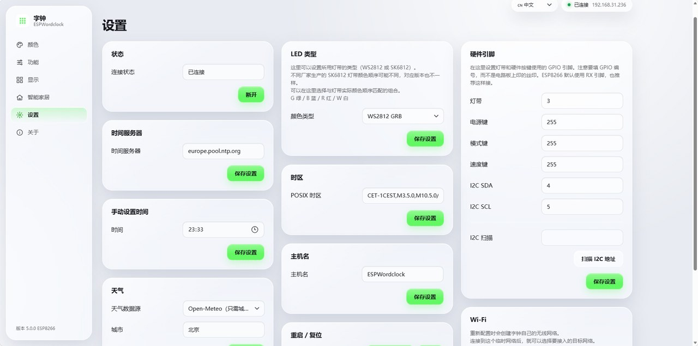

<!-- 页面大标题的中文（放在正文第一行，不会显示） -->

<!-- ↓↓↓ 英文正文 ↓↓↓ 哨兵 span 必须保留在块内第一行 ↓↓↓ -->

## Overview

A traditional word clock lights up a few words on a grid. This one does it in **Chinese** — and the Chinese reading layout is written in whole phrases, which leaves roughly a third of the printed film permanently dark. Instead of wasting those cells, this build puts them to work: **weekday**, **weather condition**, and **sign + temperature** rows were added to the last lines of the panel, with the temperature readout down to **1 °C**.

The firmware is a fork of the open-source [Multilayout-ESP-Wordclock 5.0.0](https://github.com/ESPWortuhr/Multilayout-ESP-Wordclock) (ESP8266), extended with a custom **ZH10x11** Chinese layout, two weather back-ends, and a fully translated Chinese web interface.

## Highlights

- **11×10 + 4 LED matrix** — 110 WS2812/SK6812 pixels behind an acrylic silkscreen film, 4 corner LEDs for minutes, separated by a light-blocking support plate (one cavity per character).
- **ZH10x11 Chinese layout** — glyph "superstrings": one cell can belong to several words, and font outlines are generated straight from the font file with fontTools, no Inkscape round-trip.
- **Weather to 1 °C** — row 8 shows the sign and tens digit, row 9 the units digit and 度; the film was redesigned together with the firmware so nothing is faked.
- **Dual weather sources** — keyless [Open-Meteo](https://open-meteo.com) by default (plain HTTP, just type a city name), QWeather kept as an option (HTTPS + gzip on a 30 KB heap via MFLN).
- **Chinese web UI** — i18next with a complete 297-key `zh` language pack; the clock auto-matches `zh-CN` browsers.
- **Full OTA** — firmware updates from the web UI at `http://<ip>:81/update`, EEPROM layout versioned so settings survive upgrades.

## What the series covers

The whole development and debugging process is published as a bilingual series, [*From an LED board to a Chinese word clock*](/wordclock-series/) (7 parts, Chinese/English):

1. Prologue: hardware v1 — LED board, acrylic film, light-blocking plate
2. Two dead weather rows: a diagnosis that started at "the display looks fine"
3. TCP connects, but no response ever arrives
4. TLS and 6 KB JSON in a 30 KB heap
5. `wdt reset` on boot: static init, DNS timeout, heap fragmentation
6. One degree on a Chinese clock: glyphs, layout, and film geometry
7. Just type a city: keyless weather and the `zh-CN` i18n trap

## The configuration UI

The web UI is fully bilingual (EN/中文 via the selector at the top). The settings page shows connection state, LED type and colour order, NTP server and POSIX timezone, the weather source (Open-Meteo with a plain city name, or QWeather with location ID / key / dedicated host), I2C pins for peripherals, and Wi-Fi provisioning.

## Status

Hardware v1 (LED board, silkscreen film, support plate) is built and validated; firmware is in daily use.

**Source code:** [github.com/bi4wmslabs/Multilayout-ESP-Wordclock-ZH](https://github.com/bi4wmslabs/Multilayout-ESP-Wordclock-ZH) — the full fork (ZH10x11 layout, weather back-ends, Chinese web UI), forked from [ESPWortuhr/Multilayout-ESP-Wordclock](https://github.com/ESPWortuhr/Multilayout-ESP-Wordclock) (BSD-3-Clause). Firmware is open source; hardware design files (silkscreen SVGs, 3D models, laser-cutting templates, schematics) are not published.

<!-- ↓↓↓ 中文正文 ↓↓↓ -->

## 概述

传统的字钟在一块字符网格上点亮几个词。这一台是**中文**的——而中文读数按整词书写，丝印板上大约三分之一的格子常年黑着。与其浪费，不如利用起来：在面板最后几行加入**星期**、**天气状况**和**符号+温度**行，并把温度读数精确到 **1℃**。

固件基于开源项目 [Multilayout-ESP-Wordclock 5.0.0](https://github.com/ESPWortuhr/Multilayout-ESP-Wordclock)（ESP8266）二次开发，扩展了自绘的 **ZH10x11** 中文布局、双天气数据源和完整的中文网页配置界面。

## 亮点

- **11×10 + 4 灯珠矩阵**——110 颗 WS2812/SK6812 藏在亚克力丝印板后，4 颗角落灯负责分钟，中间是隔光支撑板（一字一腔，防串光）。
- **ZH10x11 中文布局**——字模「超串」设计：一个格子可以同时属于多个词；字模轮廓用 fontTools 直接从字体文件生成，不走 Inkscape。
- **温度精确到 1℃**——第 8 行显示符号与十位，第 9 行显示个位和「度」；丝印与固件一次联动设计，不掺假。
- **双天气数据源**——默认免 key 的 [Open-Meteo](https://open-meteo.com)（明文 HTTP，网页上只填城市名），保留和风天气（HTTPS + gzip，靠 MFLN 在 30 KB 堆里跑通）。
- **中文网页界面**——i18next 加完整 297 键的 `zh` 语言包，浏览器是 `zh-CN` 时自动匹配。
- **完整 OTA**——网页里访问 `http://<ip>:81/update` 即可升级固件，EEPROM 布局带版本号，配置可跨升级保留。

## 系列文章

完整的开发与调试过程整理为中英双语系列，[《从一块灯板到一台中文字钟》](/wordclock-series/)（共 7 篇）：

1. 序章：硬件第一版——灯板、丝印板、隔光板
2. 天气两行全灭：一次「显示没问题」的排查
3. TCP 连得上，却永远等不到响应
4. 在 30 KB 堆里同时装下 TLS 和 6 KB JSON
5. 开机就 `wdt reset`：静态初始化、DNS 超时与堆碎片
6. 让中文字钟精确到 1℃：字模、布局与丝印几何
7. 只填一个城市：免 key 天气源与 `zh-CN` 的坑

## 配置界面

网页界面中英双语（右上角可切换）。设置页包含连接状态、LED 类型与颜色顺序、NTP 服务器与 POSIX 时区、天气数据源（Open-Meteo 只填城市名，或和风天气的 Location ID / Key / 专属 Host）、外设 I2C 引脚以及 Wi-Fi 配网。

## 当前状态

硬件第一版（灯板、丝印板、隔光板）已制作并验证通过，固件在日常使用中。

**源码仓库**：[github.com/bi4wmslabs/Multilayout-ESP-Wordclock-ZH](https://github.com/bi4wmslabs/Multilayout-ESP-Wordclock-ZH)——包含本分支全部改动（ZH10x11 布局、天气后端、中文界面），基于 [ESPWortuhr/Multilayout-ESP-Wordclock](https://github.com/ESPWortuhr/Multilayout-ESP-Wordclock)（BSD-3-Clause）二次开发。本仓库仅开源固件；丝印 SVG、3D 模型、激光切割模板、电路图等硬件设计文件不随仓库发布。

